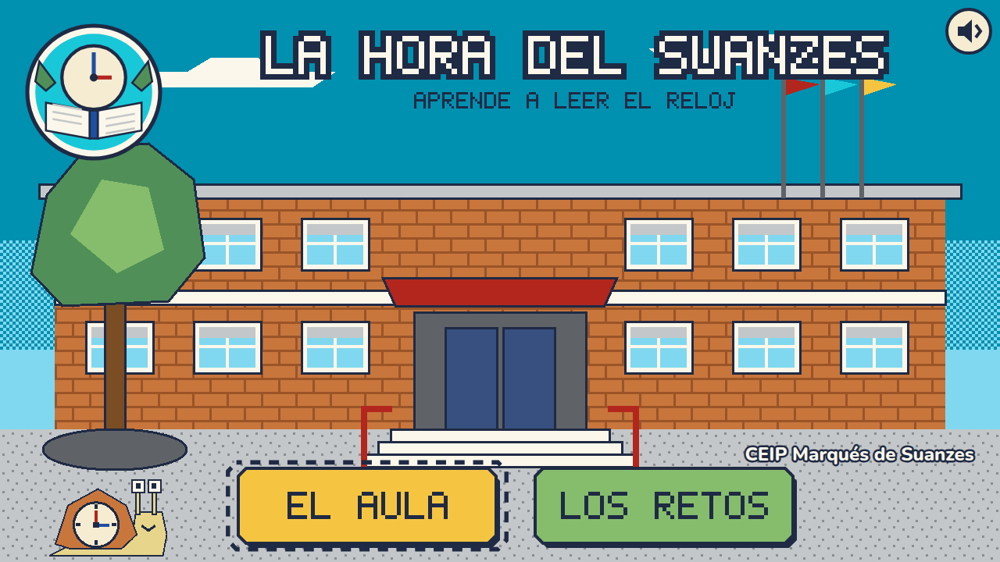
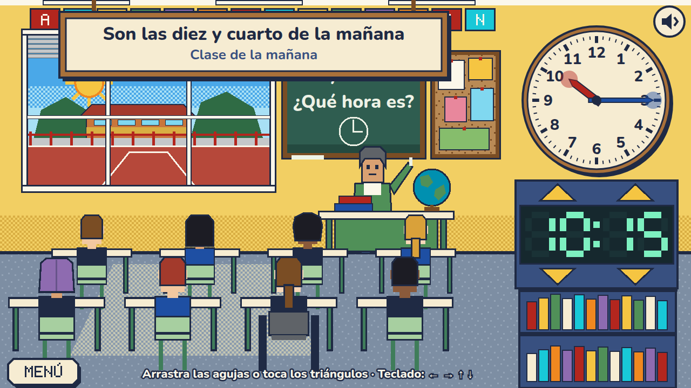
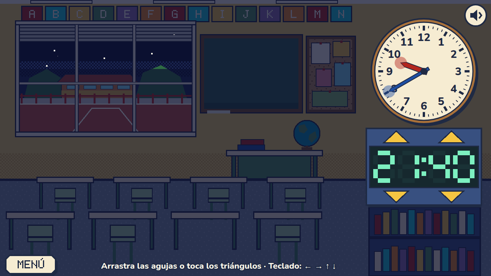
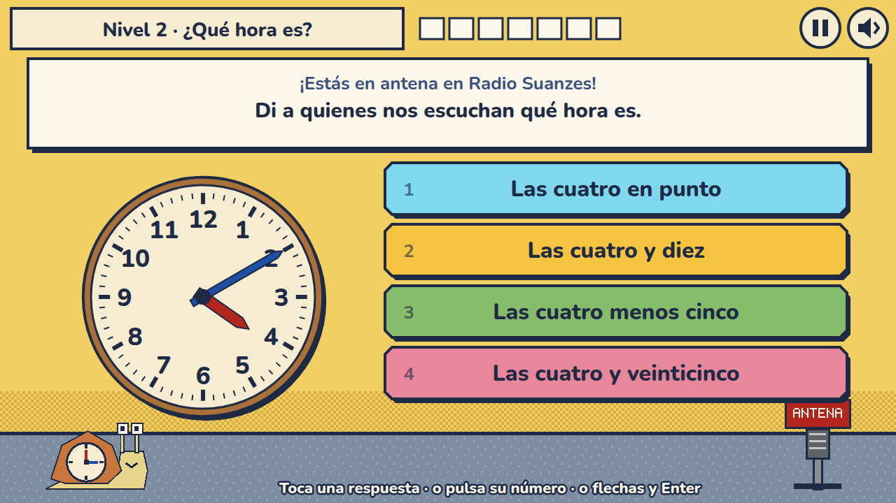
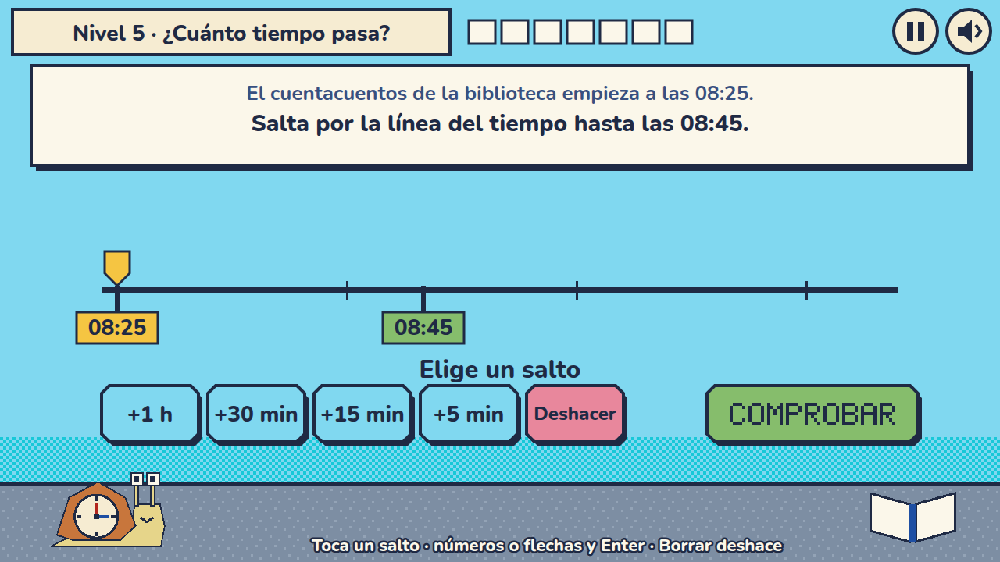

# La hora del Suanzes 🕰️

A retro point-and-click-style game for learning to tell the time, set in a Spanish primary school (CEIP Marqués de Suanzes, Madrid). For children of about 7 to 10. The game is in Spanish.

Pure HTML + CSS + JavaScript: no dependencies, no build step, no external network. All art is hand-written SVG and all sound is synthesized.



| | |
| --- | --- |
|  |  |
|  |  |

## Play

The timetable is a JSON file loaded over HTTP, so the game needs a local server (opening `index.html` directly will not work):

```sh
make serve   # then open http://localhost:8000
make open    # or serve it and open your default browser
```

## How it works

**El aula (simulator).** Drag the hands of the analog clock or use the triangles of the digital one. The classroom follows the time: lessons, recess, lunch, an empty room in the afternoon and darkness at night, with the sun crossing the window. Each time you let go you hear a soft *clonc* and a sign tells you the time in words.

**Los retos (game).** Three worlds of three levels each:

1. **¿Qué hora es?** Read analog and digital clocks, up to the minute and in 24-hour format.
2. **¿Cuánto tiempo pasa?** Work out elapsed time, with a timeline to hop along.
3. **Suma y resta.** Add and subtract hours and minutes.

Exercises come with small stories from school life: Radio Suanzes, the vegetable garden, the dining hall, the playground, a trip to the planetarium. There are no lives and no timer. After a mistake the game explains why, and the exercise comes back later in the level. Stars depend on how many you got right at the first try.

## Change the timetable

Edit [`data/schedule.json`](data/schedule.json) and reload; no code needs to change. Each event says when it starts and which scene to show, and it lasts until the next event starts:

```json
{ "id": "lunch", "time": "12:30", "scene": "lunch", "text": "Todos al comedor" }
```

Available scenes are `dark`, `empty`, `arrival`, `lesson`, `recess` and `lunch`. If the file has a mistake, the game shows what is wrong instead of starting. The exercises read the school's times from this file too. The recess time is an assumption, because the school does not publish it.

## Controls

| | Mouse or touch | Keyboard |
| --- | --- | --- |
| Clock hands | Drag them | `←` `→` choose hours or minutes, `↑` `↓` change them |
| Digital clock | Tap or hold the triangles | Same keys |
| Answers | Tap | Number keys, or arrows and `Enter` |
| Sound | Speaker button | `M` |
| Pause or back | Button | `Esc` or `P` |

## Privacy

Progress is stored only on this device, in `localStorage`. No cookies, no accounts, no analytics, and nothing is sent anywhere.

## Development

```sh
make test     # unit tests with node
make check    # syntax check
make verify   # end-to-end checks in headless Chrome, including a bot that plays all 9 levels
make shots    # retake the screenshots
make dist     # copy the publishable files to dist/
```

`AGENTS.md` describes the structure and the conventions.

## License

MIT, see [LICENSE](LICENSE). Fonts: Fredoka and Nunito, under the SIL Open Font License (see `assets/fonts/`). The emblem and characters are original; this project uses no official logo of the school.
